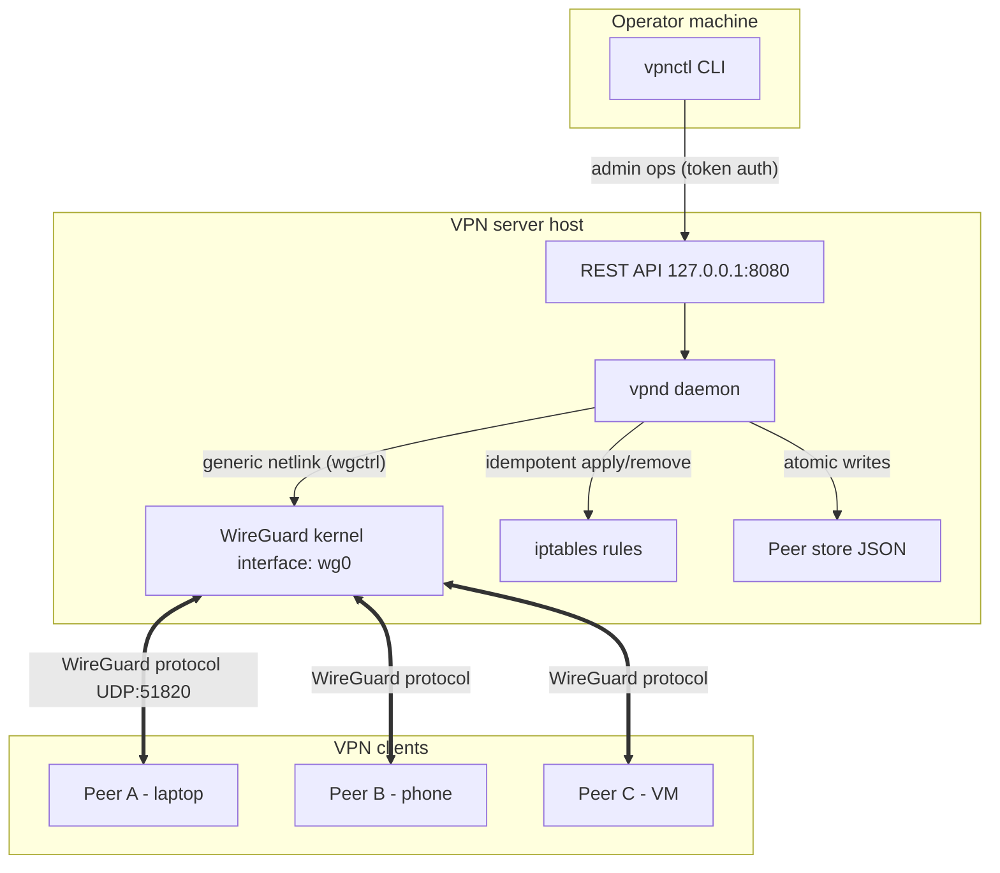
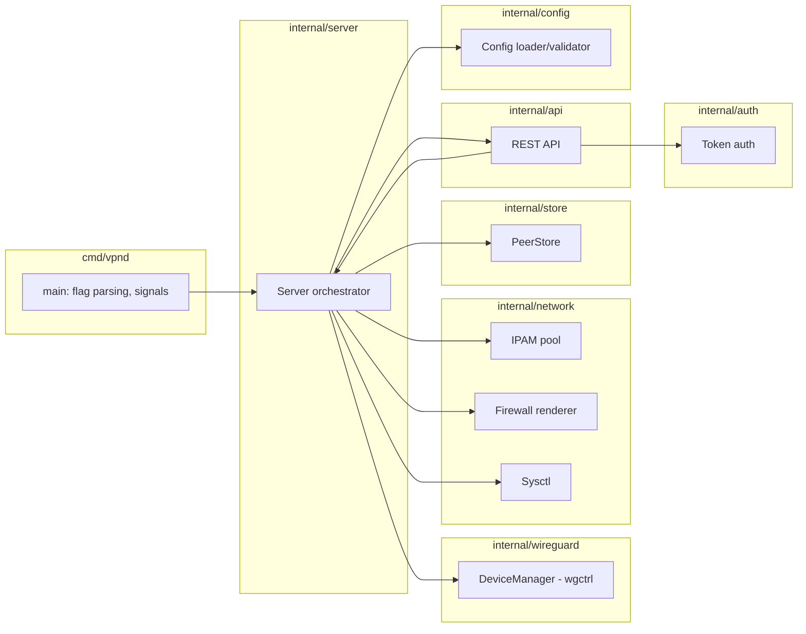

# Architecture

## System Context

## Component View (in-process)

## Data Flow: peer provisioning

1. Operator calls `POST /api/v1/peers` with the peer public key + name.
2. API validates token (`internal/auth`, constant-time compare).
3. Server asks IPAM for a free address inside `network.address` (persisted allocation).
4. Peer record (key, address, name, timestamps) is persisted by PeerStore (atomic tmp+rename).
5. `DeviceManager.AddPeer` programs the peer into the kernel via wgctrl.
6. Firewall renderer refreshes rules (masquerade + forward + per-peer rules).
7. Operator can render the client-side config via `vpnctl` and hand it to the peer.

## Security boundaries

| Boundary | Control |
| --- | --- |
| Internet ↔ WireGuard UDP port | WireGuard cryptographic handshake (Noise_IK); no custom crypto anywhere. |
| Host ↔ admin REST API | API binds 127.0.0.1 by default; bearer token with constant-time comparison. |
| vpnd ↔ kernel | wgctrl via generic netlink; requires `CAP_NET_ADMIN` (see ADR-006). |
| Store ↔ disk | Atomic writes; file mode 0600; store contains public keys only, never private keys of peers. |

## Failure & recovery

- Store is the source of truth for desired peer state; kernel state is reconciled
  from it on every start (idempotent reconciliation loop).
- SIGHUP triggers config reload + reconcile; SIGTERM/SIGINT tears down what the
  daemon created (interface removal optional, controlled by config).
